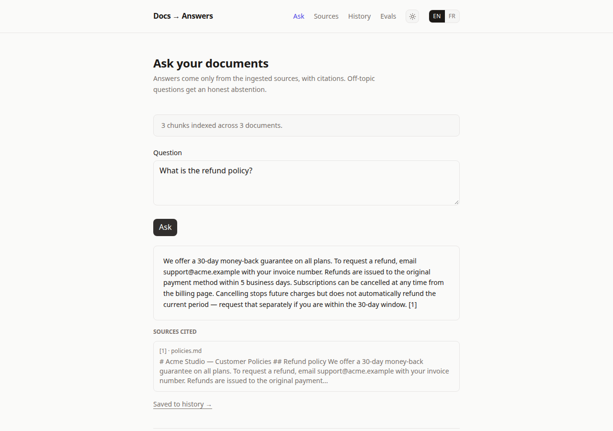
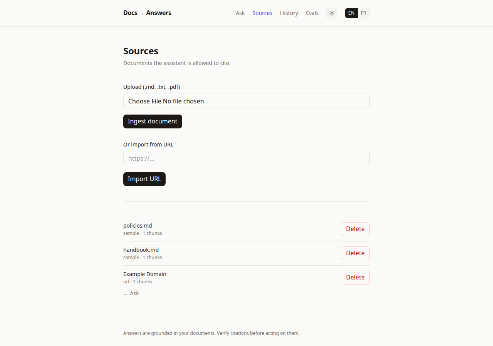
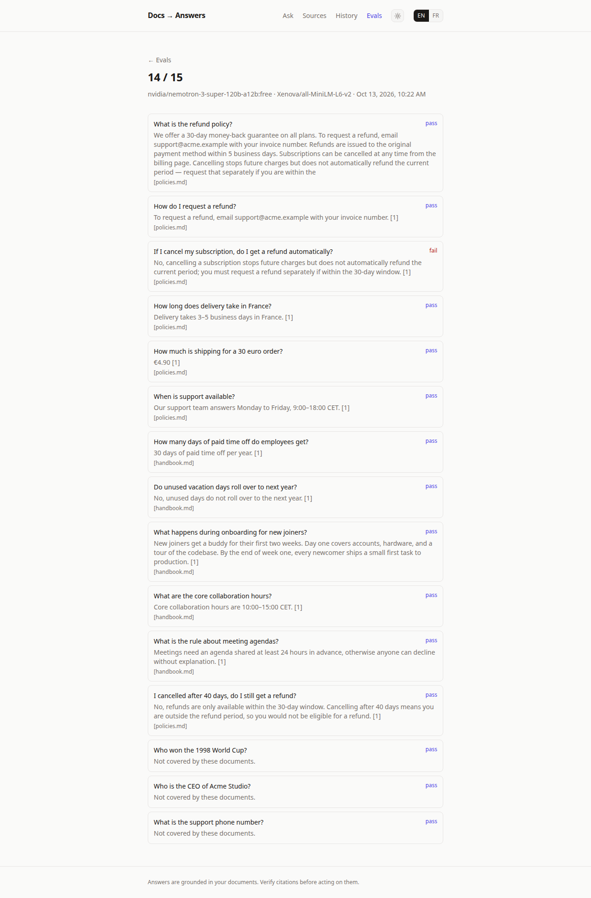

# Docs → Answers

Ask questions over your documents. Answers are **grounded**: every claim
cites the exact source chunk, and off-topic questions get an honest
abstention instead of a hallucination.



Portfolio project **#2 of 3**. #1 (`meeting-to-actions`) shows structured
extraction from transcripts; this one shows **retrieval**: chunking, local
embeddings, vector search, grounded generation - and the part juniors
usually skip, **evals**.

**Eval score: 14/15** on the bundled set (see [Evals](#evals)). The single
miss is a real paraphrase drift, kept on purpose - see the eval notes.

## Demo in 2 minutes

1. `npm install && npm run dev` → http://localhost:3000
2. Click **Load sample handbook** (no API key needed).
3. Ask *"What is the refund policy?"* → streamed answer with `[1]` citation;
   click through to **Sources cited**.
4. Ask *"Who won the 1998 World Cup?"* → clean abstention.
5. Open **Evals** → **Run evals** → per-question pass/fail table.




## Architecture

```
          ┌─────────────┐
          │  md / txt / │  PDF (pdf.js) / URL (cheerio)
          │  PDF / URL  │──────────┐
          └─────────────┘          ▼
                        ┌──────────────────┐
                        │ chunk (~500 tok,  │
                        │ paragraph-aware,  │
                        │ word overlap)     │
                        └────────┬─────────┘
                                 ▼
                        ┌──────────────────┐
                        │ local embeddings │  all-MiniLM-L6-v2,
                        │ (Transformers.js)│  384 dims, sqlite BLOB
                        └──────────────────┘

  question ──► embed ──► cosine top-6 (floor 0.25) ──► prompt ──► stream
                                                                     │
                                              ┌──────────────────────┴──┐
                                              │ [n] citations validated │
                                              │ NOT_IN_DOCS → abstain   │
                                              └─────────────────────────┘
```

- **Stack**: Next.js 16, React 19, Tailwind v4, `better-sqlite3`,
  Transformers.js, OpenAI SDK against OpenRouter. EN/FR, light/dark.
- **Retrieval defaults** (`src/lib/retrieval.ts`): chunks ~500 tokens /
  50 overlap, top-k 6, similarity floor 0.25, brute-force cosine in JS.
- **Generation** (`src/lib/llm.ts`): short-answers-only system prompt,
  `[n]` citation markers validated server-side (unknown ids dropped),
  exact-match `NOT_IN_DOCS` abstention.

## Evals

`data/eval-set.json` - 15 fixed questions graded **deterministically, no
LLM judge**:

| Kind | Count | Rule |
|------|-------|------|
| Answerable | 10 | all keywords present **and** expected doc cited |
| Adversarial | 2 | same rule, but the question tempts hallucination (late refund, sub-threshold shipping) |
| Unanswerable | 3 | must abstain |

Run them from **Evals** (sequential, ~25s, 1s pacing for free tier).
Runs are stored with per-question detail.

Current standing: **14/15**. The miss (`cancel-subscription`) is
instructive: the doc says *"from the billing page"*, the model paraphrased
it away, the grader caught it. Loosening the keyword would green the suite
and teach nothing - it stays red until retrieval or prompting genuinely
fixes it.

## Keys

- **Embeddings are local** - no key, no cost, works offline. The model
  downloads once into `./data/models` (git-ignored).
- **Answering + evals need a key**: copy `.env.example` to `.env`, set
  `OPENAI_API_KEY` (OpenRouter, free-tier keys work; default model is a
  free one). Without it, ingest/search/browse all work; Ask and Evals show
  an honest notice instead of crashing.

## Production-swap notes (deliberately not built)

- Vector search: brute-force cosine → **pgvector** (or sqlite-vss) past
  ~10k chunks; the `retrieveChunks` boundary is the only code that changes.
- Ingest: inline server actions → background jobs past ~100 pages.
- Multi-user: add auth + per-user corpora (schema is single-user today).
- Judge: keyword grading → LLM judge + human spot-checks once the set
  grows past ~50 questions.

## Develop

```bash
npm install
npm run dev      # http://localhost:3000
npm run lint
npm run build
```

Sample corpus lives in `data/sample-docs/` (fake "Acme Studio" handbook -
the eval set is graded against it, so edit both together).
